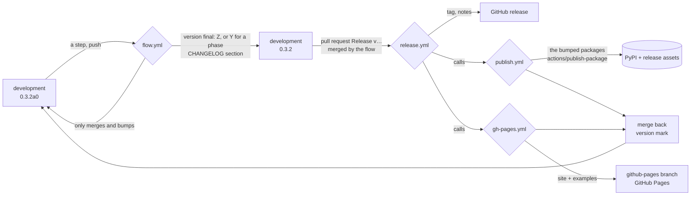

# Map

Everything in this repository and how it moves. Keep it true: a change of
structure, a workflow or a tool updates this map in the same commit.

## Places

| Place | What | Who writes |
| ----- | ---- | ---------- |
| `src/amoorion/` | the package: core and namespaces (`docs/structure.md`) | agents |
| `packages/amoorion-
/` | one plugin package per platform, tested against fakes | agents (`task plugin:new`) |
| `tools/amoorion-dev/` | development tools, never published | agents |
| `examples/*.ipynb` | notebooks, run by the tests; `examples/build/` ignored | agents |
| `tests/`, `packages/*/tests/`, `tools/*/tests/` | pytest; `tests/live/` only when named | agents |
| `packages/*/src/*/schema.vault.json` | what a plugin's vault entry holds (`Plugin.schema()`, `task vault:new`) | agents |
| `docs/platforms/<platform>.md` | the page of a package: its README and schema | agents |
| `skills/<name>/SKILL.md` | agent skills for using amoorion; also served by the docs at `/skills/` | agents |
| `docs/_static/`, `docs/_extra/` | the docs' style (after the web page), `robots.txt`; `llms.txt`, page Markdown and 404 are built | agents |
| `resources/` | the author's graphics: logo, mockup | **author** |
| `docs/contributing.md` | contributors guide: pull, change, push, versions | agents |
| `docs/*.md`, `docs/conf.py` | the docs site (Sphinx, MyST); `docs/api/`, `docs/examples/`, `docs/devlog/STATE.md` are built | agents |
| `docs/devlog/ORDERS.md` | the author's answers to `Q<n>` | **author**; agents empty it |
| `docs/devlog/INQUIRIES.md` | the author's requests in their own words | **author**; agents empty it |
| `docs/devlog/VISION.md`, `TODO.md` | the plan and its checklist, by phase | agents, from the author's words |
| `docs/devlog/BRAINSTORM.md` | open questions `Q<n>` with a *Lean:* | agents ask, the author decides |
| `docs/changelog/phase-<n>.md` | the story: orders word for word, decisions, what was done; **append-only** | agents |
| `CHANGELOG.md` | the commits per release; written by `amoorion-dev version final` | the flow |
| `docs/.agents/` | this map, the guide, the notes, `CLEO.md` (Cleo's own view); the author reads it | agents |
| `.github/flow.toml` | settings of the loop: bot, branches, phase releases, PyPI | the author |
| `.github/workflows/`, `.github/actions/` | the automation below | agents |
| `lefthook.yml`, `Taskfile.yml` | git hooks, the root of the tasks: setup and check | agents |
| `tests/`, `examples/`, `docs/`, `scripts/`, `tools/`: `Taskfile.yml` | the tasks of each directory's context; the first three are submenus (`task test:live`), the last two flattened into the root's names (`task vault:login`) | agents |

## The release loop

Every package has its own version (`amoorion-dev version`, `task version`):

| Release | When | Bumped |
| ------- | ---- | ------ |
| `Z` | every push | `amoorion`, and the packages changed since the last release |
| `Y` | a phase completed since the last release | all, to `amoorion`'s version |
| `X` | `release.major_after_phase` completed | all |

| Stage of `amoorion` | Example | Where |
| ------------------- | ------- | ----- |
| released | `0.3.1`, tag `v0.3.1` | master; development after the merge back |
| pre-release | `0.3.2a0` | development, being made |
| final | `0.3.2`, no tag | development, while the flow releases it |

## Workflows

| Workflow | Starts on | Does | Starts |
| -------- | --------- | ---- | ------ |
| `check.yml` | push (not `github-pages`), pull request, by hand, by flow | `task check` | — |
| `flow.yml` | push to development, by hand | version final, pull request to master, its merge (`release.automerge`) | check, release |
| `release.yml` | push to master, by hand, by flow | `task check`, tag, GitHub release with notes; calls publish and gh-pages; then the merge back into development | — |
| `publish.yml` | called by release, by hand (tag, packages) | one job per bumped package → `actions/publish-package` | — |
| `gh-pages.yml` | called by release, by hand (tag) | examples (marimo) + `amoorion-dev site` → `github-pages`, served by Pages | — |

Pushes, merges and releases made with the workflows' token start no
workflow, so each workflow starts the next with `gh workflow run`.

## Tools

| Command | Task | For |
| ------- | ---- | --- |
| `amoorion-dev state [--online]` | `task state` | where development stands |
| `amoorion-dev version current\|list\|next\|mark\|final` | `task version`, `task flow:pull` | the loop |
| `amoorion-dev phases [--completed]` | | the plan; what a release completes |
| `amoorion-dev notes <tag> [--title]` | | release notes |
| `amoorion-dev packages [--only] [--released <tag>]`, `setting <key>` | | the workflows |
| `amoorion-dev site [--website website/dist]` | `task site`, `task site:website` | the web page: amoorion-website at its root, project, examples, releases, manifests |
| `amoorion-dev identity` | | the bot as git user |
| `amoorion …` | `task run` | the product's CLI; alone it asks step by step |

## Gates

- `task check` = tests (+ notebooks, workflows' shape), YAML, commit
  messages, docs build with warnings as errors, docs requirements.
- lefthook: `commit-msg` (commitizen), `post-merge` (version mark).
