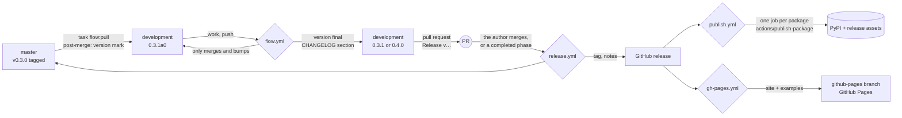

# Map

Everything in this repository and how it moves. Keep it true: a change of
structure, a workflow or a tool updates this map in the same commit.

## Places

| Place | What | Who writes |
| ----- | ---- | ---------- |
| `src/amoorion/` | the package: core and namespaces (`docs/structure.md`) | agents |
| `packages/amoorion-
/` | one plugin package per platform, tested against fakes | agents (`task plugin:new`) |
| `tools/amoorion-dev/` | development tools, never published | agents |
| `examples/*.ipynb` | notebooks, run by the tests; `examples/build/` ignored | agents |
| `tests/`, `packages/*/tests/`, `tools/*/tests/` | pytest; `tests/live/` only when named | agents |
| `docs/contributing.md` | contributors guide: pull, change, push, versions | agents |
| `docs/*.md`, `docs/conf.py` | the docs site (Sphinx, MyST); `docs/api/`, `docs/examples/`, `docs/devlog/STATE.md` are built | agents |
| `docs/devlog/ORDERS.md` | the author's answers to `Q<n>` | **author**; agents empty it |
| `docs/devlog/INQUIRIES.md` | the author's requests in their own words | **author**; agents empty it |
| `docs/devlog/VISION.md`, `TODO.md` | the plan and its checklist, by phase | agents, from the author's words |
| `docs/devlog/BRAINSTORM.md` | open questions `Q<n>` with a *Lean:* | agents ask, the author decides |
| `docs/changelog/phase-<n>.md` | the story: orders word for word, decisions, what was done; **append-only** | agents |
| `CHANGELOG.md` | the commits per release; written by `amoorion-dev version final` | the flow |
| `docs/.agents/` | this map, the guide, the notes; the author reads it | agents |
| `.github/flow.toml` | settings of the loop: bot, branches, phase releases, PyPI | the author |
| `.github/workflows/`, `.github/actions/` | the automation below | agents |
| `lefthook.yml`, `Taskfile.yml`, `docs/Taskfile.yml` | git hooks, tasks | agents |

## The release loop

Version stages (`amoorion-dev version`, `task state`):

| Stage | Example | Where |
| ----- | ------- | ----- |
| released | `0.3.0`, tag `v0.3.0` | master; development right after the pull |
| pre-release | `0.3.1a0` | development, being made |
| final | `0.4.0`, no tag | development and its pull request, ready |

The next version counts from the last release tag: breaking or `feat` →
minor (while `0.x`), a phase completed since → at least minor, else patch.

## Workflows

| Workflow | Starts on | Does | Starts |
| -------- | --------- | ---- | ------ |
| `check.yml` | push (not `github-pages`), pull request, by hand, by flow | `task check` | — |
| `flow.yml` | push to development, by hand | version final, pull request to master, phase auto-merge | check, release |
| `release.yml` | push to master, by hand, by flow | `task check`, tag, GitHub release with notes | publish, gh-pages |
| `publish.yml` | release, by hand (tag, packages) | one job per package → `actions/publish-package` | — |
| `gh-pages.yml` | release, by hand (tag) | examples (marimo) + `amoorion-dev site` → `github-pages` → Pages | — |

Pushes, merges and releases made with the workflows' token start no
workflow, so each workflow starts the next with `gh workflow run`.

## Tools

| Command | Task | For |
| ------- | ---- | --- |
| `amoorion-dev state [--online]` | `task state` | where development stands |
| `amoorion-dev version current\|next\|mark\|final` | `task version`, `task flow:pull` | the loop |
| `amoorion-dev phases [--completed]` | | the plan; what a release completes |
| `amoorion-dev notes <tag> [--title]` | | release notes |
| `amoorion-dev packages [--only]`, `setting <key>` | | the workflows |
| `amoorion-dev site` | | the web page |
| `amoorion-dev identity` | | the bot as git user |
| `amoorion …` | `task run` | the product's CLI; alone it asks step by step |

## Gates

- `task check` = tests (+ notebooks, workflows' shape), YAML, commit
  messages, docs build with warnings as errors, docs requirements.
- lefthook: `commit-msg` (commitizen), `post-merge` (version mark).
