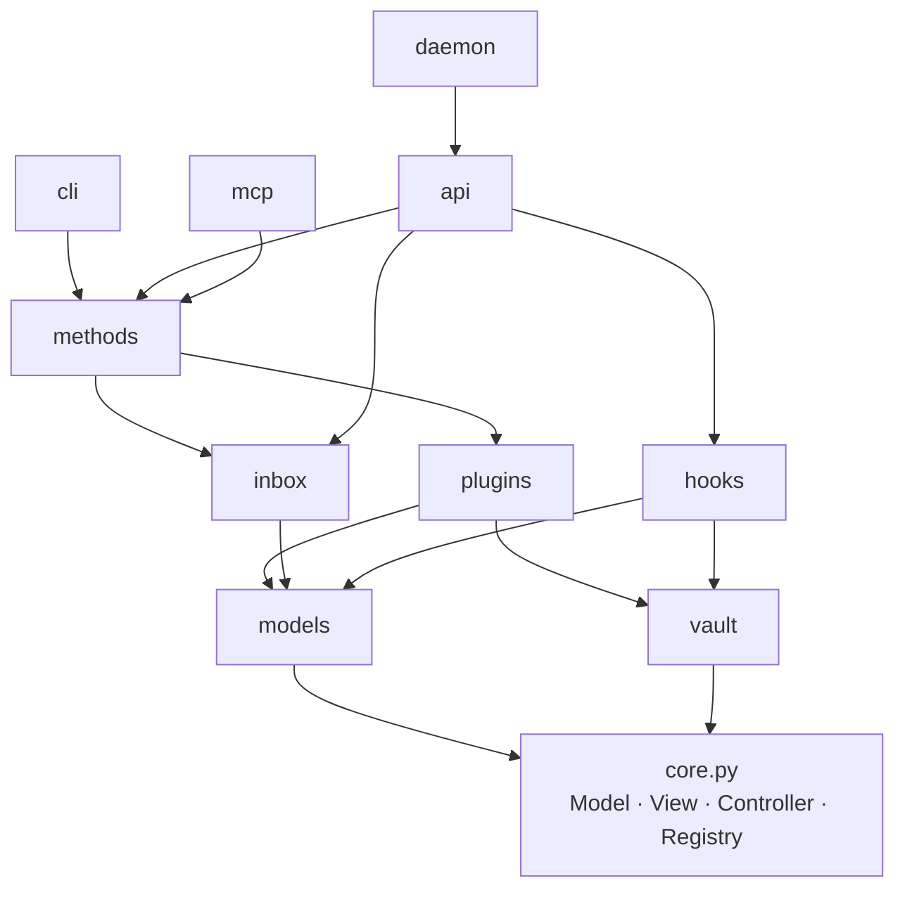

# Structure

The shape of `src/amoorion/`: one core, and namespaces built on it (orders
of phase 0, Q1). Every namespace keeps its own core mechanics in
`<namespace>/base.py`; the ones that can run on their own also have
`<namespace>/__main__.py` (`python -m amoorion.<namespace>`).

```
src/amoorion/
├── __init__.py      version, `main` (the `amoorion` command → cli)
├── core.py          Model, View, JsonView, Controller, Registry, AmoorionError
├── models/          data shared by all: Account, Post, Message, Result
├── vault/           link to the secrets vault (.env); one module per backend
├── plugins/         plugin interface, HttpPlugin, entry point loading; dryrun/
├── methods/         operations, one file each: <name>_method.py; base.py is what they share
├── inbox/           received messages of every platform, SQLite (Q11)
├── dataset/         the posts of every profile on every platform, JSON files (Q14)
├── hooks/           incoming webhooks → messages
├── nats/            results of methods out, a subject into the inbox
├── cli/             command line: methods as subcommands, servers   (__main__)
├── api/             HTTP API: methods and hooks over HTTP            (__main__)
├── mcp/             MCP server: methods as tools for AI agents       (__main__)
└── daemon/          long-running services in one process            (__main__)

packages/            one package per platform, a uv workspace (Q10)
└── amoorion-<platform>/   pyproject.toml (entry point), src/amoorion_<platform>/, tests/
```

| Package | Platform | Can | Through |
| ------- | -------- | --- | ------- |
| `amoorion-bluesky` | Bluesky | post, read, reply, delete | AT Protocol (XRPC), app password |
| `amoorion-mastodon` | Mastodon | post, read, reply, delete | REST API, access token |
| `amoorion-ntfy` | ntfy | post, read | HTTP, optional access token |
| `amoorion-email` | e-mail | post, read, reply | SMTP and IMAP, encrypted only |
| `amoorion-x` | X (twitter) | post, read, reply, delete | API v2, OAuth 1.0a |
| `amoorion-tumblr` | Tumblr | post, read, delete | API v2 (Neue Post Format), OAuth 1.0a |
| `amoorion-blogger` | Blogger | post | e-mail to the blog's secret address (SMTP, TLS) |
| `amoorion-facebook` | Facebook Page | post, read, reply (comments), delete | Graph API, Page token |
| `amoorion-discord` | Discord | `discord`: post, read, reply, delete; `discord-webhook`: post, delete | bot token (REST API); channel webhook (Q12) |
| `amoorion-telegram` | Telegram | post, read, reply, delete | Bot API, bot token |
| `amoorion-matrix` | Matrix | post, read, reply, delete (redact) | client-server API, access token |

Every package's README lists its secrets. Each is tested against a fake of
its API; `tests/live/` tries each against its real account, only when asked
(`task test:connect`, read-only, and `task test:live`, posting; every platform
with its secrets, or those named, Q13).

## How they depend on each other



Front-ends (`cli`, `api`, `mcp`, `daemon`) never talk to plugins directly:
everything a person or an agent can do is a **method**. A new operation is
written once in `methods/` and shows up as a CLI subcommand, an API route
and an MCP tool.

## Core: model, view, controller

| Class | In `core.py` | Specialized as |
| ----- | ------------ | -------------- |
| `Model` | pydantic model, unknown fields refused | `models.*`, method params, `VaultLink`, `PluginInfo` |
| `View` | `render(model or list)` | `JsonView` (API, MCP, `--json`), `cli.RichView` (tables) |
| `Controller` | `name`, `description`, a view, `respond()` | `Plugin`, `Method`, `Hook`, `Vault`, `Service`, `Daemon` |
| `Registry` | controllers of one kind by name | `PLUGINS`, `METHODS`, `HOOKS`, vault `BACKENDS` |

## Namespaces

### `models/`

`Account` (platform, handle), `Post` (what to publish: text, title, links,
tags), `Message` (something said on a platform: post, chat line, hook event),
`Result` (one platform's outcome of a method).

### `vault/`

Secrets never live in the repository or in `.env` (Q3). `.env` holds only the
link: `AMOORION_VAULT` (backend), `AMOORION_VAULT_ADDR`,
`AMOORION_VAULT_TOKEN`, `AMOORION_VAULT_PATH`; see `example.env`. Secrets are
named `<platform>/<key>`; every backend keeps one entry per platform with a
field per key. One module per backend (Q6):

| Module | Kind | Where `bluesky/password` is |
| ------ | ---- | --------------------------- |
| `bw_cli.py` | `bitwarden` | item `amoorion/bluesky`, login password (other keys: custom fields) |
| `http_vault.py` | `http` | KV v2 `secret/amoorion/bluesky`, key `password` |
| `kpxc_db_file.py` | `keepassxc` | entry `bluesky` in group `amoorion`, password |
| `default.py` | `env` | variable `AMOORION_SECRET_BLUESKY_PASSWORD` (development) |

### `plugins/`

`Plugin` declares `capabilities` (`post`, `read`, `reply`) and the vault keys
it needs (`secrets`), and implements the calls; anything else raises
`Unsupported`. `HttpPlugin` adds JSON-over-HTTP calls with the platform's
own error reasons. Plugins are found through the entry point group
`amoorion.plugins`, loaded on first use; one that fails to load is listed
with its error. The platforms are packages in `packages/` (above); only
`dryrun` is built in. How to write one: [plugins.md](plugins.md).

### `methods/`

`Method` has `Params` (a model) and `run(params)` returning models.
`read_only` marks methods that change nothing. Each lives in its own
`<name>_method.py`, with its params next to it (`all_params.py` lists them all)
and its import in `methods/__init__.py`, which is what registers it. Built in: `accounts` (which
platforms have their secrets; values never shown), `plugins`, `publish` (one
post to many platforms, one `Result` each, a failing platform doesn't stop
the others), `read` (keeps what it read in the inbox and the dataset),
`reply`, `inbox`, `snapshot` (reads a profile's posts into the dataset; when
it got fewer than it asked for, it read them all, and the ones not seen any
more are marked `gone`), `delete` (keeps a copy in the dataset, then
deletes on the platform; not read-only).

### `dataset/`

What amoorion knows of the posts on each platform (Q14), as JSON files,
one directory per profile (the account, page, blog, channel or room a
plugin speaks as or in: `Plugin.profile()`):

```
dataset/<platform>/<profile>/index.json        every post known: id, url, time, state, a bit of text
dataset/<platform>/<profile>/posts/<id>.json   each post as last read
dataset/<platform>/<profile>/deleted/<id>.json what `delete` removed, kept before it went
```

A post is `present`, `gone` (no longer there when a read covered all) or
`deleted` (by amoorion). Where: `AMOORION_DATASET` in `.env`, default
`./dataset` (ignored by git). Ids become file names readable and unique.

### `nats/`

Off unless `AMOORION_NATS` names a server. What a method that changes
something returned goes out on `<prefix>.methods.<name>` (a failure there
never fails the method); the daemon keeps what arrives on `<prefix>.in.>` in
the inbox as `nats:<subject>`.

### `inbox/`

What amoorion received, of every platform, kept once by platform and id in
a SQLite file (`AMOORION_INBOX` in `.env`, default
`$XDG_DATA_HOME/amoorion/inbox.sqlite3`). `read` and the hooks put messages
in; the `inbox` method lists them, newest first, optionally of one platform
(hooks are `hook:<name>`: `generic`, `github`, `gitlab`, `discord`). Rules acting on them come in phase 5 (Q11).

### `hooks/`

`Hook.verify(body, headers)` first, then `receive(payload) → Message`. A hook
whose secret is missing from the vault refuses everything. Built in:
`generic` (`{"text", "author"}` with `X-Amoorion-Token` = secret
`hooks/generic-token`).

### `cli/`

`amoorion <method> --<param> …`, `--json` for machine output; `amoorion`
alone in a terminal (or `-i`) asks step by step: the method from a table,
each parameter, platforms offered by what they can do, a confirmation
before anything changes on a platform (`cli/guide.py`); `amoorion api`,
`amoorion mcp`, `amoorion daemon` start the servers.

### `api/`

FastAPI: `GET /`, `POST /methods/<name>` (body = params; `Authorization:
Bearer` = secret `api/token`, without it method calls are off),
`POST /hooks/<name>` (the message goes to the inbox). Binds `127.0.0.1:8000` by default.

### `mcp/`

MCP server (stdio, or streamable HTTP): every method is a tool, read-only
methods carry `readOnlyHint`.

### `daemon/`

`Service` (`run`, `stop`) and `Daemon` running them side by side; when one
ends or fails, the others stop. Services now: the API. Later: platform
listeners (bots) and NATS subscribers.

## From Python: `amoorion.app`

`Amoorion` is one setup as an object: its vault, dataset and inbox, the platforms
in use and its flags. Every method is callable by its name (`amo.publish(...)`),
`api()`, `mcp()` and `cli()` give the front-ends on that same setup, `save` and
`load` keep where things are and hashes to detect changes (`changes()`), never a
secret. `Plugins` is the collection of what is installed, at rest. See the
notebooks of `examples/`.

## What it does by itself: `amoorion.workflows`

`workflow` runs methods one after another, passing on `$last`. `automate` runs rules
on the inbox: for each new matching message, its steps, with `$text`, `$author`,
`$platform`, `$id` and `$url`. A rule acts once per message and a failed one is tried
again next time. Beware of a rule publishing to where it reads: what it said is a new
message it may match. Steps can't start other steps.

## Around the methods: `society`, `utilities`

`compose` asks any server with OpenAI's chat completions API (Ollama, llama.cpp, a
LiteLLM proxy, OpenAI, Claude, Hugging Face), from `llm/url`, `llm/model` and the
optional `llm/token` of the vault. `simulate` lets personas react to a topic in
memory; no plugin is involved, so nothing it says can reach a platform. `wiki` gives
a Wikipedia summary. `amoorion.utilities` has `post_from_markdown` and `open_tunnel`
(ngrok, not a dependency). The hooks `sentry` and `plane` join github, gitlab, discord.
