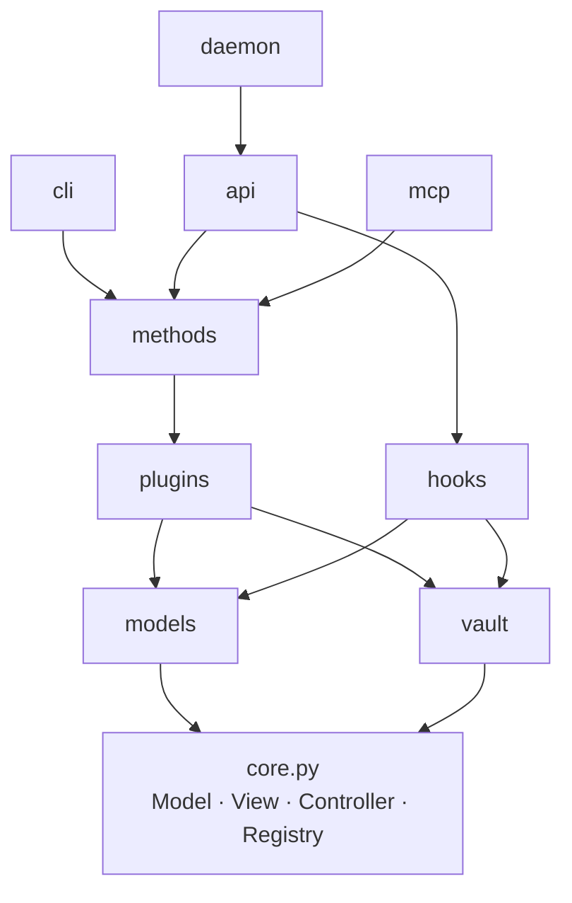

# Structure

The shape of `src/amoorion/`: one core, and namespaces built on it (orders
of phase 0, Q1). Every namespace keeps its own core mechanics in
`<namespace>/base.py`; the ones that can run on their own also have
`<namespace>/__main__.py` (`python -m amoorion.<namespace>`).

```
src/amoorion/
├── __init__.py      version, `main` (the `amoorion` command → cli)
├── core.py          Model, View, JsonView, Controller, Registry, AmoorionError
├── models/          data shared by all: Account, Post, Message, Result
├── vault/           link to the secrets vault (.env) and its backends
├── plugins/         one plugin per platform; dryrun/ for development
├── methods/         operations over the platforms: plugins, publish, read
├── hooks/           incoming webhooks → messages
├── cli/             command line: methods as subcommands, servers   (__main__)
├── api/             HTTP API: methods and hooks over HTTP            (__main__)
├── mcp/             MCP server: methods as tools for AI agents       (__main__)
└── daemon/          long-running services in one process            (__main__)
```

## How they depend on each other



Front-ends (`cli`, `api`, `mcp`, `daemon`) never talk to plugins directly:
everything a person or an agent can do is a **method**. A new operation is
written once in `methods/` and shows up as a CLI subcommand, an API route
and an MCP tool.

## Core: model, view, controller

| Class | In `core.py` | Specialized as |
| ----- | ------------ | -------------- |
| `Model` | pydantic model, unknown fields refused | `models.*`, method params, `VaultLink`, `PluginInfo` |
| `View` | `render(model or list)` | `JsonView` (API, MCP, `--json`), `cli.RichView` (tables) |
| `Controller` | `name`, `description`, a view, `respond()` | `Plugin`, `Method`, `Hook`, `Vault`, `Service`, `Daemon` |
| `Registry` | controllers of one kind by name | `PLUGINS`, `METHODS`, `HOOKS`, vault `BACKENDS` |

## Namespaces

### `models/`

`Account` (platform, handle), `Post` (what to publish: text, title, links,
tags), `Message` (something said on a platform: post, chat line, hook event),
`Result` (one platform's outcome of a method).

### `vault/`

Secrets never live in the repository or in `.env` (Q3). `.env` holds only the
link: `AMOORION_VAULT` (backend), `AMOORION_VAULT_ADDR`,
`AMOORION_VAULT_TOKEN`; see `example.env`. Secrets are named
`<platform>/<key>`. Backends: `env` (development:
`AMOORION_SECRET_<PLATFORM>_<KEY>`); the first real vault is open (Q6).

### `plugins/`

`Plugin` declares `capabilities` (`post`, `read`, `reply`) and implements
them; anything else raises `Unsupported`. A plugin reads its secrets from
the vault with `self.secret("<key>")`. One directory per platform:
`plugins/<platform>/base.py`, registered in `PLUGINS`. How outside packages
add plugins is open (Q7).

### `methods/`

`Method` has `Params` (a model) and `run(params)` returning models.
`read_only` marks methods that change nothing. Built in: `plugins`,
`publish` (one post to many platforms, one `Result` each, a failing
platform doesn't stop the others), `read`.

### `hooks/`

`Hook.verify(body, headers)` first, then `receive(payload) → Message`. A hook
whose secret is missing from the vault refuses everything. Built in:
`generic` (`{"text", "author"}` with `X-Amoorion-Token` = secret
`hooks/generic-token`).

### `cli/`

`amoorion <method> --<param> …`, `--json` for machine output; `amoorion api`,
`amoorion mcp`, `amoorion daemon` start the servers.

### `api/`

FastAPI: `GET /`, `POST /methods/<name>` (body = params; `Authorization:
Bearer` = secret `api/token`, without it method calls are off),
`POST /hooks/<name>`. Binds `127.0.0.1:8000` by default.

### `mcp/`

MCP server (stdio, or streamable HTTP): every method is a tool, read-only
methods carry `readOnlyHint`.

### `daemon/`

`Service` (`run`, `stop`) and `Daemon` running them side by side; when one
ends or fails, the others stop. Services now: the API. Later: platform
listeners (bots) and NATS subscribers.
